<div align="center">

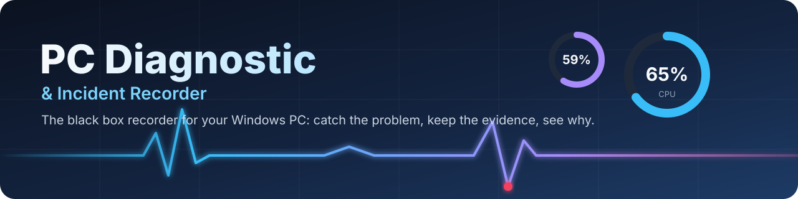

<br>

[](https://github.com/ameralqarallih-lgtm/PC-Diagnostic/releases/download/v1.0.8/PcDiagnostic-Setup-1.0.8.exe)

[](LICENSE)


**A free, open-source "black box" for Windows.** It quietly keeps a rolling history of everything your PC does.
When something goes wrong (a flicker, a freeze, a crash, a stutter, overheating), it keeps the minutes **before and after**,
lines them up on one timeline and tells you what stood out, in plain words.

[Download](#download) ·
[Screenshots](#screenshots) ·
[Features](#features) ·
[How it works](#how-it-works) ·
[User guide](#user-guide) ·
[Build from source](#build-from-source) ·
[Tech stack](#tech-stack) ·
[Built by AI](#built-by-ai) ·
[Support](#support)

</div>

---

<a id="why"></a>

##  Why PC Diagnostic?

Most monitoring tools show you **now**. By the time you open them, the problem is gone.
PC Diagnostic records **all the time**, at a cost it shows you (it slows itself down if it ever goes above 2 % CPU), so the evidence is already there when you need it.

| | |
|---|---|
|  **Always recording** | A rolling memory of the last minutes at full detail, plus 30 days of one-minute summaries. |
|  **Incidents with evidence** | Press a hotkey (even in a full-screen game), or let a rule catch it: the minutes before and after are saved with every process, event and reading. |
|  **Explains, never guesses** | Findings say what happened and how sure they are ("GPU clock fell 71 % in 1 s while utilization stayed at 56 %"), never a made-up cause. |
|  **On-screen readings** | Designable panels on your monitors and USB sensor screens, with animated characters that react to your PC. |
|  **Local only** | Nothing recorded ever leaves your PC. No account, no telemetry, no cloud. |
|  **Free forever** | GPL-3.0. Every feature for everyone: no key, no trial, no editions. |

---

<a id="download"></a>

##  Download

<table>
<tr>
<td width="70%">

### PC Diagnostic **v1.0.8** for Windows 10/11 (x64)

 **[PcDiagnostic-Setup-1.0.8.exe](https://github.com/ameralqarallih-lgtm/PC-Diagnostic/releases/download/v1.0.8/PcDiagnostic-Setup-1.0.8.exe)** (197 MB) · [all releases](https://github.com/ameralqarallih-lgtm/PC-Diagnostic/releases) · [what changed](CHANGELOG.md)

SHA-256: `ADF025BBC9F64F26860904D9CC46673719B2C535F4963DFE6F2D31B7002C6B6C`

One installer, nothing else to install: the .NET runtime is inside, and the sensor driver (PawnIO) is offered during setup.

</td>
<td width="30%">

**Needs**
- Windows 10 or 11, 64-bit
- A few hundred MB of disk for the history (the limit is yours to set)
- Administrator rights once, during setup
- Optional: an NVIDIA GPU with CUDA to generate new characters

</td>
</tr>
</table>

> [!NOTE]
> The installer is not code-signed yet, so Windows SmartScreen may say *"Windows protected your PC"*. Choose **More info → Run anyway**, or check the SHA-256 above first (`Get-FileHash .\PcDiagnostic-Setup-1.0.8.exe`).

---

<a id="screenshots"></a>

##  Screenshots

<table>
<tr>
<td width="50%">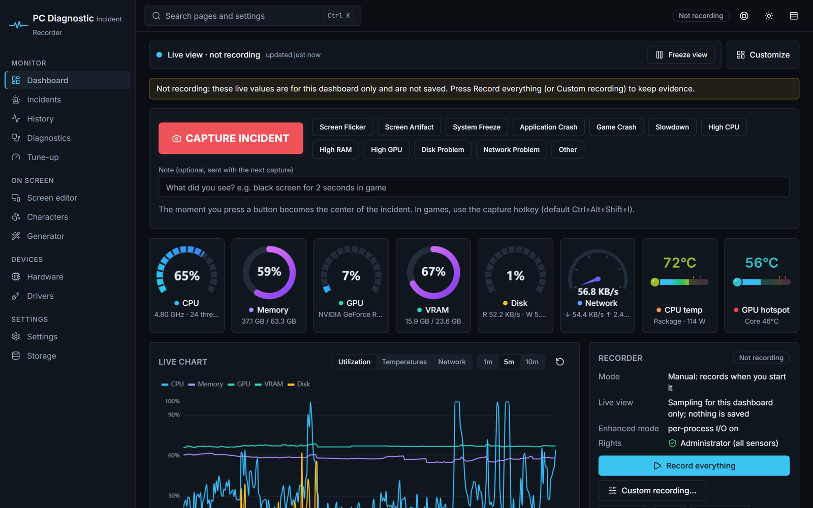<br><b>Dashboard</b>: live gauges, one-click incident capture, streaming charts and the recorder's state.</td>
<td width="50%">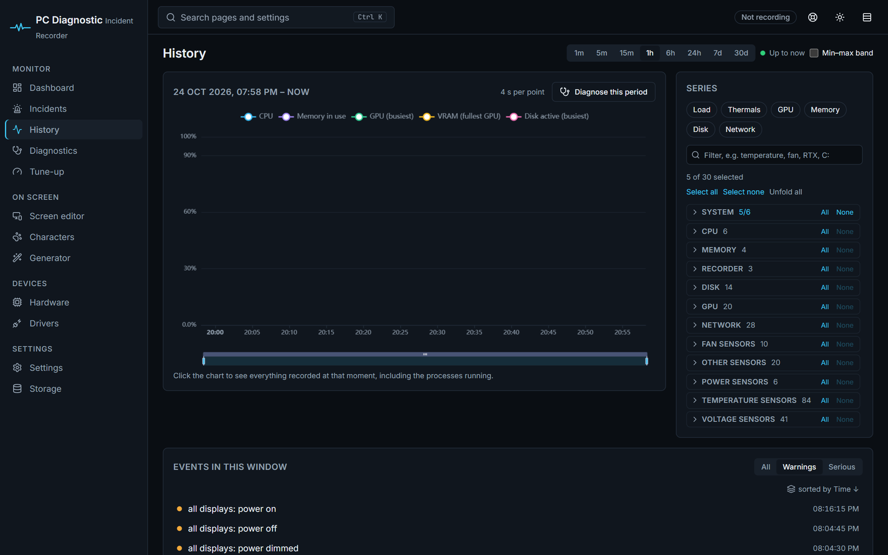<br><b>History</b>: any recorded series from 1 minute to 30 days, with every event of the window.</td>
</tr>
<tr>
<td>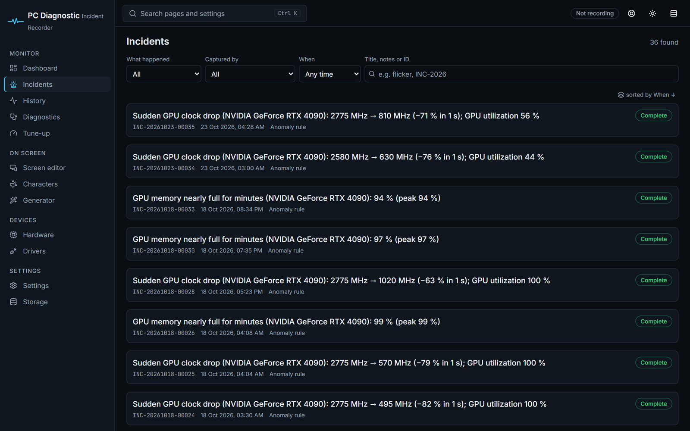<br><b>Incidents</b>: everything captured by you or by the rules, filtered by kind, source and time.</td>
<td>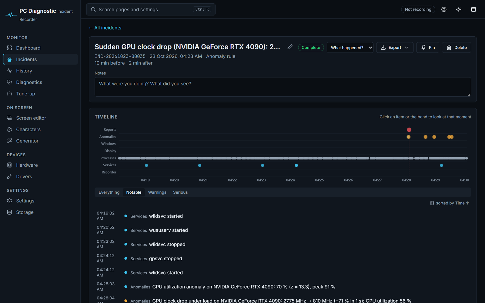<br><b>Incident</b>: the timeline of the minutes around it (processes, services, displays, anomalies), with findings and exports.</td>
</tr>
<tr>
<td>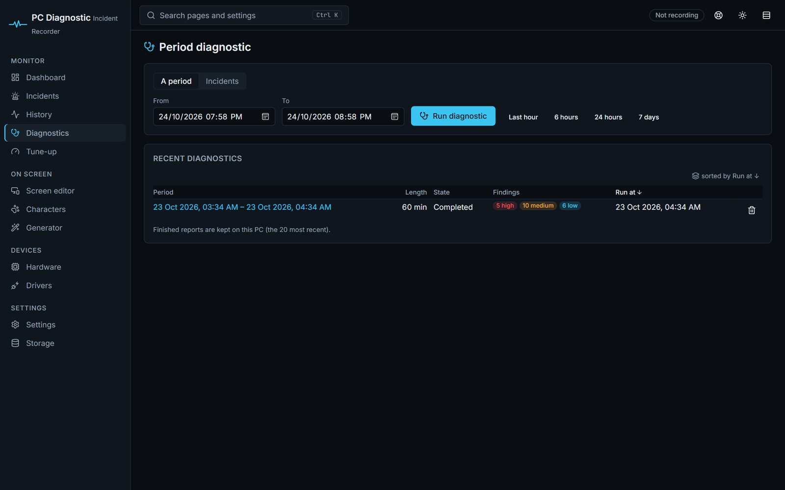<br><b>Diagnostics</b>: a deep check of any period or set of incidents, run in the background, graded high / medium / low.</td>
<td>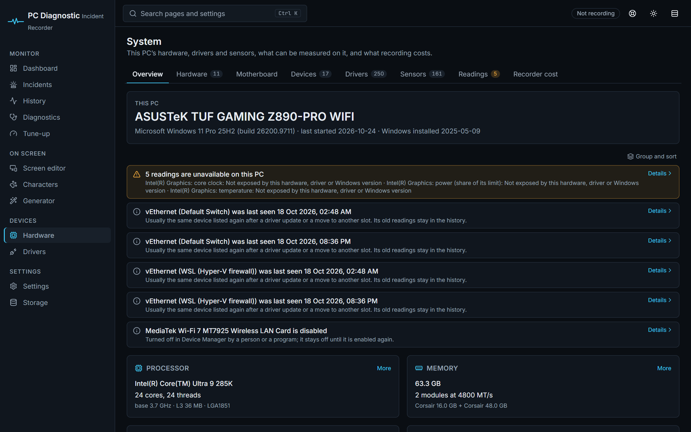<br><b>System</b>: hardware, drivers, devices and sensors, and why any reading is unavailable, in words you can act on.</td>
</tr>
<tr>
<td>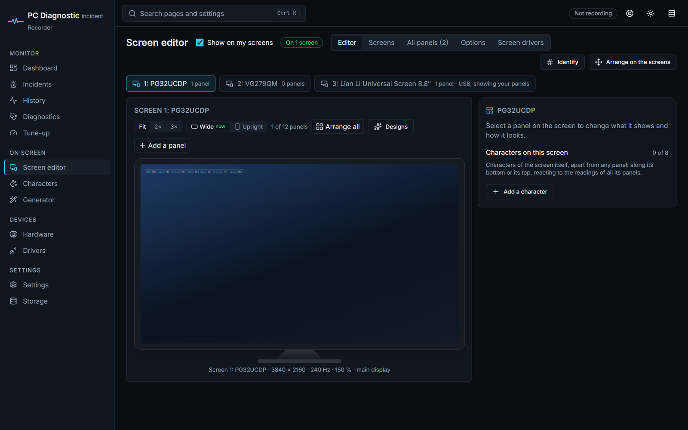<br><b>On-screen</b>: design panels of live readings for each monitor or USB sensor screen, from twelve ready-made designs.</td>
<td>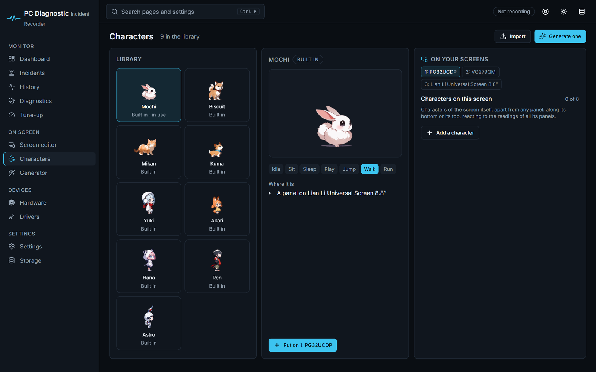<br><b>Characters</b>: nine animated characters that live on your panels and react to what your PC is doing.</td>
</tr>
</table>

---

<a id="features"></a>

##  Features

<details open>
<summary> <b>Recording: what it watches</b></summary>

| Area | What is recorded |
|---|---|
| **CPU & memory** | Load per core, clocks, temperature and package power, memory in use, commit, compression, page faults. |
| **GPU** (every adapter) | Engine utilization, VRAM, temperature and hotspot, clocks, power and its limit, fans, throttle reasons (NVML for NVIDIA, the RTX 50 series hotspot from its thermal registers through PawnIO, D3DKMT for any vendor). |
| **Disks** | Throughput, IOPS, latency, queue length, active time, free space, health and wear (SMART / NVMe log). |
| **Network** | Throughput per interface, errors, link speed, Wi-Fi signal, latency. |
| **Processes** | Every process every 2 s: CPU, memory, disk and network I/O, GPU; started, stopped and hung programs. |
| **Windows** | Classified events: GPU driver resets, app crashes and hangs, blue screens, unexpected restarts, WHEA hardware errors, disk and NTFS errors, service failures, sleep and resume. |
| **Displays** | Active monitors, resolution, refresh rate, HDR, orientation, and every change with the moment Windows reported it. |
| **Sensors** | Motherboard, fans, voltages and coolers through LibreHardwareMonitor (well over a hundred sensors on a typical desktop). |
| **Games** | Frame rate, frame time and stutter of the app in front (Enhanced mode adds a flight recorder and true per-process I/O through ETW). |

Recording modes: **Manual**, **Always**, **Scheduled**, or a **custom recording** of only the readings you pick. Even when not recording, it *watches* in memory and starts recording when a problem appears.

</details>

<details>
<summary> <b>Incidents, rules and findings</b></summary>

- **Capture** from the global hotkey <kbd>Ctrl</kbd>+<kbd>Alt</kbd>+<kbd>Shift</kbd>+<kbd>I</kbd> (works in full-screen games), the tray icon, the dashboard's buttons (*Screen Flicker*, *Game Crash*, *Slowdown*…) or the command line.
- **Automatic incidents** from transparent anomaly rules (sudden GPU clock drops, VRAM full for minutes, CPU at 100 %, a disk stalling, a driver reset…) and from blue screens or unexpected shutdowns.
- Each incident gets **its own self-contained folder**: the minutes before (default 10) and after (default 2), every process, snapshots of hardware, drivers and displays, and a timeline.
- **Findings** grade what stood out and quote the numbers; they suggest what to check, never invent a cause.
- **Reports** as HTML or PDF (quick or technical), and **exports** as CSV, JSON or ZIP.

</details>

<details>
<summary> <b>On-screen panels, USB screens and characters</b></summary>

- Panels of live readings on any monitor: rows, a line or tiles; rings, arcs, speedometers, bars, thermometers and graphs; moving backgrounds; twelve designs (Glass Mono, Neon Tokyo, Synthwave, Carbon Racing…).
- **USB sensor screens** that use the TURZX protocol (such as the Lian Li Universal Screen 8.8″) are driven directly, no vendor app needed.
- Panels stay **click-through**, hide in full-screen games if you want, and can be kept out of screenshots and recordings.
- **Animated characters** (Mochi, Biscuit, Mikan, Kuma, Yuki, Akari, Hana, Ren, Astro) walk on your panels and react:
  they run to a reading that turns bad, cool a hot GPU with an ice pack or a fire extinguisher, ride a gauge's needle, run in a ring like a hamster in its wheel, celebrate when things are good again, notice your mouse, enjoy being petted, meet each other, and (if you choose a place) show the weather.
- A **character generator** makes new characters and animations from a text prompt with local AI models.

</details>

<details>
<summary> <b>System, tune-up and more</b></summary>

- **System**: hardware, motherboard, devices, drivers (with signatures), every sensor, and why a reading is unavailable.
- **Drivers**: install Windows drivers for devices that have none, and keep driver packages.
- **Tune-up**: advice from what the PC is really doing, startup programs, services and safe clean-up.
- **Access from other devices** (off by default): view the dashboard from your phone or another PC on your network, with pairing codes and HTTPS; an **Android companion app** is included.
- **Storage**: keep history on other drives or S3-compatible storage, with limits and automatic clean-up.

</details>

---

<a id="how-it-works"></a>

##  How it works

PC Diagnostic is two programs that trust each other as little as possible:

- **The recorder** (`PcDiag.Agent`) runs with administrator rights so it can read every sensor. It has **no network code at all** (a test enforces it).
- **The dashboard host** (`PcDiag.Web`) runs as you, listens on `127.0.0.1` only, and talks to the recorder through a per-user named pipe.

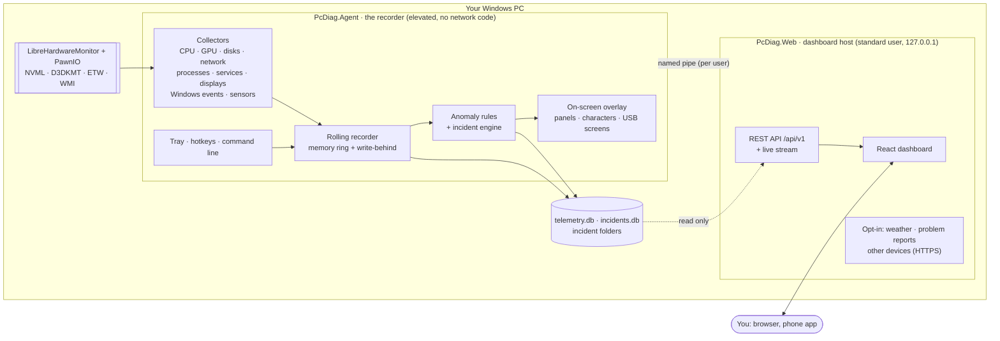

### An incident, step by step

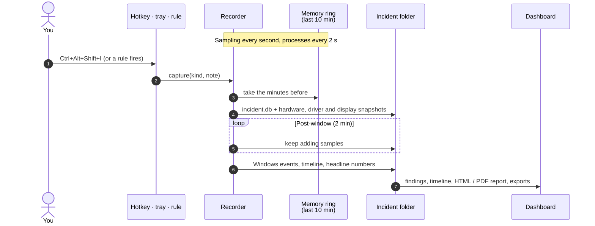

### Where everything lives

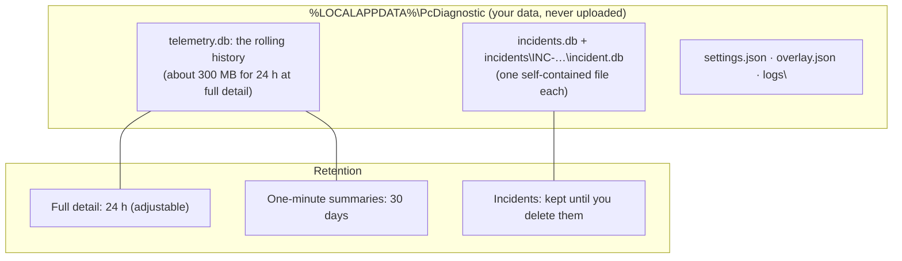

### The building blocks

| Project | Role |
|---|---|
| `src/PcDiag.Agent` | The recorder: hosts the collectors, the rolling recorder, incidents, the tray icon, hotkeys, the on-screen overlay and the command pipe. |
| `src/PcDiag.Web` | ASP.NET Core host on `127.0.0.1`: the dashboard, `/api/v1`, live streams, reports (PDF through Edge), access from other devices. |
| `src/PcDiag.Collectors` | CPU, memory, GPU, disk, network, process, service, display and event collectors. |
| `src/PcDiag.Engine` | Recording control, anomaly rules, incidents, findings, period diagnostics, live feed, Enhanced mode. |
| `src/PcDiag.Core` | Domain model and contracts, no Windows or storage dependencies (also the characters' mind, reactions and props). |
| `src/PcDiag.Storage.Sqlite` | SQLite schema, migrations, write-behind storage and readers. |
| `src/PcDiag.Storage.Files` | Other storage locations: folders, drives, S3-compatible services. |
| `src/PcDiag.Platform.Windows` | Windows APIs: displays, inventory, signatures, shell, services. |
| `src/PcDiag.Sensors.LibreHardwareMonitor` | Motherboard, CPU, fan and cooler sensors. |
| `src/PcDiag.Screens.Sdk` · `src/PcDiag.Drivers.Io` | USB sensor screens and their I/O. |
| `src/PcDiag.Hosting` | Shared start-up for both programs: logging, crash capture, paths. |
| `web/` | The React + TypeScript dashboard (Vite). |
| `android/` | The companion app (platform APIs only). |
| `installer/` | Inno Setup script, build script, third-party notices. |
| `tools/` | Character generator (Python), stress kit, problem-report service, one-command runner. |

---

<a id="tech-stack"></a>

##  Tech stack

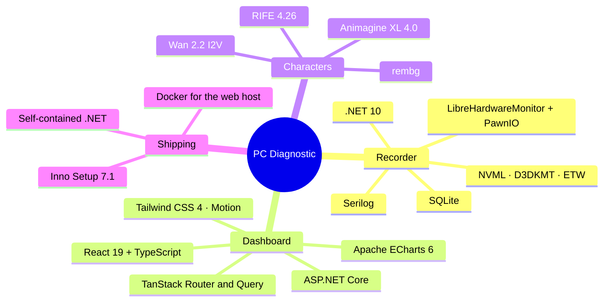

<details>
<summary><b>Every library, with its license</b></summary>

**Recorder and dashboard host (.NET 10)**

| Library | Version | License | Used for |
|---|---|---|---|
| .NET / ASP.NET Core | 10.0 | MIT | Runtime (bundled, self-contained) and the web host |
| Microsoft.Data.Sqlite | 10.0.12 | MIT | All storage |
| LibreHardwareMonitorLib | 0.9.6 | MPL-2.0 | Motherboard, CPU, fan and cooler sensors (unmodified) |
| Microsoft.Extensions.Hosting / Options / Logging | 10.0.12 | MIT | Hosting, configuration |
| System.Management · System.Diagnostics.EventLog · Microsoft.Win32.SystemEvents | 10.0.12 | MIT | WMI, Windows events, session events |
| System.IO.Ports | 10.0.3 | MIT | USB sensor screens (serial) |
| System.Security.Cryptography.ProtectedData | 10.0.12 | MIT | Storage keys under DPAPI |
| AWSSDK.S3 | 4.0.25.3 | Apache-2.0 | S3-compatible storage locations |
| Serilog (+ Hosting, Compact, Console, File) | 10.0 / 3.0 / 6.1 / 7.0 | Apache-2.0 | Logs |

**Dashboard (web/)**

| Library | Version | License | Used for |
|---|---|---|---|
| React · React DOM | 19.3 | MIT | UI |
| TypeScript · Vite | 7.0 · 8.3 | Apache-2.0 · MIT | Language and build |
| TanStack Router · TanStack Query | 1.170 · 5.104 | MIT | Routing, data fetching |
| Apache ECharts | 6.1 | Apache-2.0 | Gauges, streaming charts, History |
| Tailwind CSS · Motion | 4.3 · 14.0 | MIT | Styling, animation |
| react-grid-layout · react-resizable | 2.3 · 3.2 | MIT | The customizable dashboard |
| lucide-react · Radix Slot · clsx · tailwind-merge · class-variance-authority | latest | ISC / MIT | Icons, components |
| Inter · JetBrains Mono (Fontsource) | 5.3 | OFL-1.1 | Fonts |
| qrcode-generator | 2.0 | MIT | Pairing QR codes |

**Bundled programs and tools**

| Component | Version | License | Used for |
|---|---|---|---|
| PawnIO | 2.2.0 | GPL-2.0 (shipped unmodified, a separate program) | The driver LibreHardwareMonitor needs for CPU sensors |
| Inno Setup | 7.1 | Inno Setup License | The installer (portable, nothing installed while building) |
| SeaweedFS | pinned | Apache-2.0 | Optional local S3-compatible storage |
| Microsoft Edge (already on Windows) | system | — | PDF reports (headless print) |

**Character generator (tools/character-gen, optional, local GPU)**

| Model | License | Used for |
|---|---|---|
| Animagine XL 4.0 | CreativeML Open RAIL++-M | Character stills |
| Wan 2.2 I2V A14B (GGUF) + Lightning LoRA | Apache-2.0 | Animation clips |
| RIFE 4.26 | MIT | Seamless loops |
| rembg (isnet) | MIT | Cut-outs |

**Tests**: xUnit, NSubstitute, Shouldly, Microsoft.AspNetCore.Mvc.Testing (Apache-2.0 / BSD-3 / MIT) and Vitest + Testing Library (MIT).

The installer build reads every package it ships, writes `THIRD-PARTY-NOTICES.txt` and **fails on a license that is not allowed** (see [docs/ARCHITECTURE.md §2a](docs/ARCHITECTURE.md)).

</details>

---

<a id="user-guide"></a>

##  User guide

### 1. Install and first start

1. Run **PcDiagnostic-Setup-1.0.8.exe** and keep the recommended options:
   - **Start the recorder when I sign in**: a scheduled task starts it with administrator rights, without a UAC prompt each time.
   - **Install the PawnIO driver**: needed for CPU temperature and power.
   - *Let my other devices reach the dashboard* is optional (a firewall rule for your local network only).
2. Open **PC Diagnostic** from the Start menu. The recorder starts and the dashboard opens in your browser, already signed in (a one-time link; nothing to remember).

### 2. Record

The default mode is **Manual**: press **Record everything** on the dashboard (or *Start recording* in the tray). Choose **Always** or a **schedule** in *Settings → Recording*. While not recording, it still watches in memory and starts recording by itself when a problem appears.

### 3. Capture a problem

When something goes wrong, press <kbd>Ctrl</kbd>+<kbd>Alt</kbd>+<kbd>Shift</kbd>+<kbd>I</kbd>, or click a kind on the dashboard (*Screen Flicker*, *System Freeze*, *Game Crash*, *Slowdown*…). Add a note if you like ("black screen for 2 s in game"). The moment you press becomes the center of the incident.

### 4. Investigate

- **Incidents** → open one: the timeline of everything around it, the findings, and *Export* (HTML, PDF, CSV, JSON, ZIP).
- **History**: pick any series (CPU, GPU temperature, disk latency…) and any time range; click the chart to see every process running at that moment.
- **Diagnostics**: choose a period (*last hour*, *24 hours*, *7 days*…) or some incidents and run a deep check in the background.

### 5. Readings on your screens

**On-screen → Screen editor**: add a panel, pick readings and a design, place it on a monitor or a USB screen, add characters, then **Save changes**.

| Hotkey | Does |
|---|---|
| <kbd>Ctrl</kbd>+<kbd>Alt</kbd>+<kbd>Shift</kbd>+<kbd>I</kbd> | Capture an incident |
| <kbd>Ctrl</kbd>+<kbd>Alt</kbd>+<kbd>Shift</kbd>+<kbd>O</kbd> | Show or hide the on-screen panels |
| <kbd>Ctrl</kbd>+<kbd>Alt</kbd>+<kbd>Shift</kbd>+<kbd>A</kbd> | Arrange the panels on the screens themselves |

All hotkeys can be changed in Settings.

### 6. Command line

The recorder answers commands from any terminal:

```powershell
$pc = "C:\Program Files\PC Diagnostic\agent\PcDiag.Agent.exe"
& $pc status                       # mode, state, Enhanced mode, storage
& $pc start                        # start recording
& $pc stop
& $pc pause 30                     # pause for 30 minutes
& $pc resume
& $pc capture GameCrash "froze after alt-tab"
& $pc open                         # start what is needed and open the dashboard
```

Exit codes: `0` done, `1` refused, `4` recorder not running, `64` usage error.

### 7. Your data

Everything is in `%LOCALAPPDATA%\PcDiagnostic`. Sensitive collection (command lines, user names, Wi-Fi names) is **off by default**. Uninstalling keeps your recordings unless you ask to remove them.

---

<a id="build-from-source"></a>

##  Build from source

**Prerequisites**: Windows 10/11 x64 · [.NET SDK 10](https://dotnet.microsoft.com/download) · [Node.js 24 LTS](https://nodejs.org/) (build time only).

```powershell
git clone https://github.com/ameralqarallih-lgtm/PC-Diagnostic.git
cd PC-Diagnostic

dotnet build PcDiagnostic.slnx          # also builds the dashboard (npm ci + npm run build)
dotnet test  PcDiagnostic.slnx          # .NET unit and integration tests
cd web; npm test; cd ..                 # dashboard tests (Vitest)
```

### Run it

```powershell
# Everything at once: the recorder (one UAC prompt), the web host, and the dashboard signed in
.\tools\run-pcdiag.ps1 -Build
.\tools\run-pcdiag.ps1 -Stop

# Or each part on its own (development)
dotnet run --project src/PcDiag.Agent -- --Recorder:Mode=Always
dotnet run --project src/PcDiag.Web     # prints a one-time sign-in link

# Dashboard with hot reload (keep PcDiag.Web running)
cd web; npm run dev                     # http://localhost:5173
```

### Build the installer

```powershell
installer\build.ps1 -Version 1.0.8                          # artifacts\installer\PcDiagnostic-Setup-1.0.8.exe
installer\build.ps1 -CertificateThumbprint <sha1>           # also signs the programs and the installer
```

It fetches the pinned Inno Setup and PawnIO (checked by SHA-256 and signature), publishes both programs self-contained with the latest .NET 10 patch, writes the third-party notices and compiles the setup.

### Docker (the web host only)

```powershell
docker compose up -d --build            # dashboard on http://localhost:5180
docker compose logs web                 # the one-time sign-in link
docker build --target test .            # all cross-platform tests
```

The recorder always runs natively on Windows: its job is to observe this PC.

### Make new characters (optional, NVIDIA GPU)

```powershell
cd tools\character-gen
python setup.py check                   # what is missing: Python packages, models, ffmpeg, Node.js
python setup.py packages; python setup.py models
python run.py stills fox --seeds 4      # candidate stills
python run.py make fox --still ..\..\artifacts\chargen\fox\still-2.png --title Fox
```

Or do it all from the dashboard: **Generator → Generate one**. Details in [tools/character-gen](tools/character-gen/README.md).

---

<a id="built-by-ai"></a>

##  Built entirely by AI

**Every part of PC Diagnostic was made by AI.** The architecture, every line of C#, TypeScript, Python, Java and PowerShell, the 1,280+ tests, the installer, the documentation (this README included) and the screenshots' pages were written by **Claude** (Anthropic), working in Claude Code. The nine characters and their animations were generated by AI models (Animagine XL 4.0, Wan 2.2, RIFE).

The author set the goals, tried every build on real hardware and decided what came next. No line of code was written by hand.

---

<a id="support"></a>

##  Support the project

PC Diagnostic is free and will stay free. If it saved you an evening of guessing, you can help it grow:

<div align="center">

 Star the repository ·  [Report a problem](https://github.com/ameralqarallih-lgtm/PC-Diagnostic/issues) ·  [Suggest a feature](https://github.com/ameralqarallih-lgtm/PC-Diagnostic/issues)

</div>

---

<a id="contributing"></a>

## 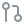 Contributing

Issues and pull requests are welcome. Before a pull request: `dotnet test PcDiagnostic.slnx` and `npm test` in `web/` should pass, and new dependencies must have a license the build allows ([§2a](docs/ARCHITECTURE.md)). The architecture, data model, API and design decisions are in [docs/ARCHITECTURE.md](docs/ARCHITECTURE.md); the original requirements are in [docs/PROJECT.md](docs/PROJECT.md).

---

<a id="license"></a>

##  License

PC Diagnostic is free and open source software: you can use, study, share and change it under the terms of the [GNU General Public License v3.0](LICENSE). Copies and changed versions you share must stay under the same license, with their source.

Third-party components keep their own licenses (listed above and in `THIRD-PARTY-NOTICES.txt`, which the installer includes). The shipped characters are original characters generated with Animagine XL 4.0 (CreativeML Open RAIL++-M) and animated with Wan 2.2 (Apache-2.0).

<div align="center">
<sub>Made by AI for everyone who ever asked "what just happened to my PC?"</sub>
</div>
